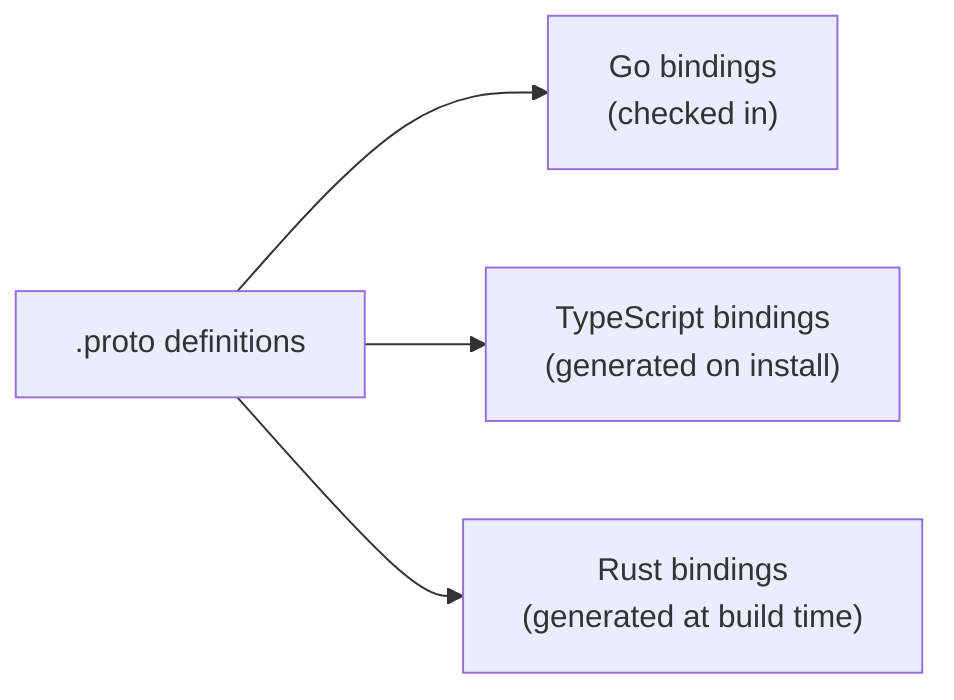
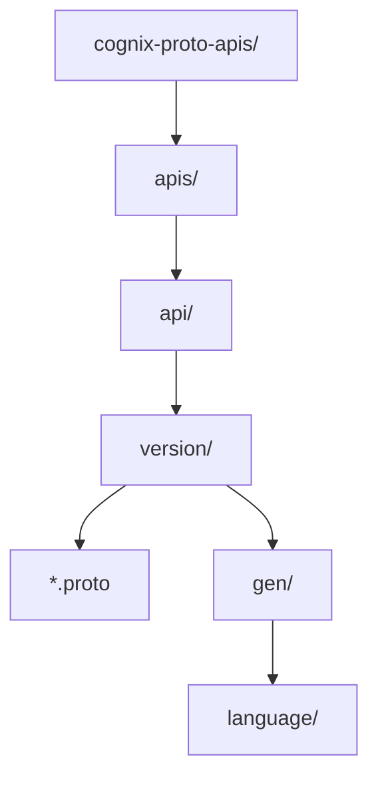
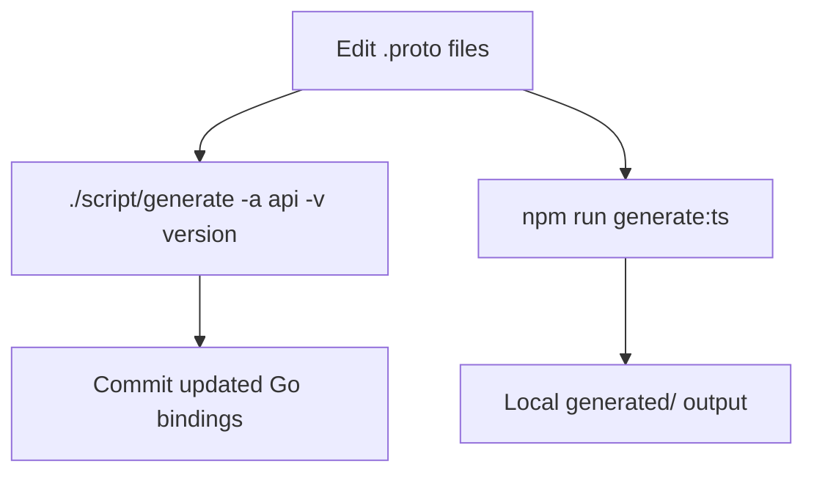

# cognix-proto-apis

Repository to centralize protobuf-based APIs for Cognix services and clients.
Maintains proto definitions alongside generated code for supported clients.

## Overview



## General structure



```
cognix-proto-apis/
└── apis/
    └── <api>/
        └── <version>/
            ├── <api>.proto   # or split across multiple .proto files
            └── gen/
                └── <bindings_for_lang>/
```

## Supported languages

| Language | Generated where | Checked into git | Tooling |
| --- | --- | --- | --- |
| Go | `apis/<api>/<version>/gen/go/` | Yes | `protoc-gen-go` |
| TypeScript | `generated/` | No | `@bufbuild/protoc-gen-es` (pinned) |
| Rust | build-time | No | `protoc` + Rust build script |

## Installing TypeScript bindings from GitHub

Install the package from a pinned commit:

```bash
npm install @cognix/multi-agent-api-v1@github:nrelab/cognix-proto-apis#<commit-sha>
```

or:

```bash
yarn add @cognix/multi-agent-api-v1@https://github.com/nrelab/cognix-proto-apis#<commit-sha>
```

Bindings are generated on the consumer's machine by the package's `prepare` script, so Git installs require:

- Node.js 22+ (required by the pinned `@bufbuild/protoc-gen-es` generator)
- `git`
- `protoc` 27.0+ in `PATH` (edition 2023 support; https://protobuf.dev/installation/)

Note: pnpm does not run `prepare` for Git dependencies by default. pnpm consumers must approve this package via
[`allowBuilds`](https://pnpm.io/settings/build) for the install to succeed.
Recent npm versions (11.17+) warn that the `prepare` script is not covered by `allowScripts`; the install still
succeeds, and the warning can be silenced with `npm approve-scripts @cognix/multi-agent-api-v1`.

Example import:

```ts
import { RequestSchema } from "@cognix/multi-agent-api-v1/request_pb";
```

## Initial setup

Run `./script/bootstrap` to install proto compiler dependencies.

## Updating generated bindings



When updating the proto definitions, run:

```bash
./script/generate -a multi_agent -v v1
```

This updates checked-in Go bindings.

### Go

Requires the `protoc-gen-go` plugin: `go install google.golang.org/protobuf/cmd/protoc-gen-go@latest`.

This is installed by the bootstrap script.

### TypeScript

TypeScript bindings are generated during package install via the root `prepare` script and are not checked into git.
`./script/generate` does not produce them. To generate them locally:

```bash
npm ci
npm run generate:ts
```

This requires `protoc` 27.0+ and writes generated files to `generated/`. The generator (`@bufbuild/protoc-gen-es`) is
pinned to an exact version in `package.json` and `package-lock.json` so output is reproducible across installs. The
generated code depends on `@bufbuild/protobuf` at runtime.

### Rust

There are no specific dependencies required for Rust, outside of the `protoc` compiler and a Rust toolchain. The Rust code generation happens at compile time (as part of a Rust build script), so no additional setup is required and nothing needs to be regenerated and checked in when proto files are modified.

## License

This project is licensed under version 3 of the GNU Affero General Public License; see LICENSE.md.
